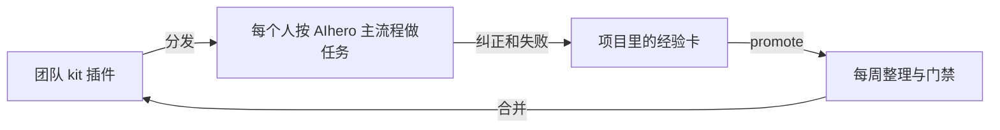

# 团队 Agent Kit

一套全团队共享、随任务自我改进的 agent 环境，以 Cursor 插件分发。装上之后：

- 每个项目用同一套工作流和标准：工作流用 [AIhero 的 skills](https://www.aihero.dev/skills)（输入 `/ask-matt` 看全图）；`/kickoff` 给每个项目建同样结构的项目层和验收标准；内核只写团队的边界和红线，比如花钱和不可逆操作前要确认。
- agent 被纠正或踩坑后会写**经验卡**；用 `/learn` 复盘分拣，项目级经验马上生效。
- 对别人也有用的经验用 `/promote` 提给团队，每周整理进团队 skill，再打包发给所有人。

设计见 [docs/architecture.md](docs/architecture.md)，术语见 [GLOSSARY.md](GLOSSARY.md)，运维见 [docs/operations.md](docs/operations.md)。

## 成员

### 安装

需要 Node 18 以上（终端里输入 `node -v` 查看）。

- **安装文件（默认）**：负责人会发给你一个 `team-kit-<版本>.cjs`。在终端（Windows 用 PowerShell）运行 `node team-kit-<版本>.cjs`，然后重启 Cursor。收到新版本再运行一次就会覆盖升级；卸载时加 `--uninstall`。
- **团队工作流**：另外装 AIhero 的 skills：`npx skills@latest add mattpocock/skills -g -a cursor -s '*' -y`。以后等负责人通知再运行 `npx skills update -g -y` 更新，让大家用同一个版本。
- **维护者**：在本仓库运行 `node scripts/install.cjs`，Cursor 直接从仓库加载，改完重载窗口就生效。
- **团队市场**（以后用上 Cursor Teams / Enterprise 时）：把本仓库导入为团队市场，`team-kit` 设为 Required，更新自动下发。
- **其他工具**（Claude Code、Codex 等）：`npx skills add <本仓库地址>`。只有 skills，没有内核和 hooks。

装好后，在 Cursor 的 Customize 里能看到 team-core 规则，kickoff、learn、promote、kit-formats 四个 skill，以及 AIhero 的 ask-matt、code-review 等。

### 日常

1. 新项目或接手旧项目：`/kickoff`，生成 `AGENTS.md`、`CODING_STANDARDS.md`（验收标准）、`HANDOFF.md` 和 `lessons/`；然后运行 `/setup-matt-pocock-skills`，配置 AIhero 用到的 issue 和领域文档。忘了也没关系：还没跑过 `/kickoff` 的项目，第一次开对话时 agent 会提醒一次。
2. 按 AIhero 的主流程做任务，不确定下一步用哪个 skill 时输入 `/ask-matt`。
3. 做完一个任务，或者每周一次：`/learn`。
4. 有团队级经验时：`/promote`。没有 kit 仓库的话，它会导出一个文件，发给负责人即可。

想让 agent 在频繁出错的会话结束时自动复盘一次，在 `~/.team-kit/config.json` 里写 `"nudge": true`。

### 花费

子 agent 要用团队列为高价的模型（见 `policy.json`）时，kit 会拦下并告诉你原因。确实需要时，在终端运行 `node ~/.cursor/plugins/local/team-kit/scripts/allow-expensive.cjs 2` 临时放开 2 小时。`node ~/.cursor/plugins/local/team-kit/scripts/stats.cjs` 能看到每次会话开了几个子 agent、有没有用到高价模型。

## 维护者

- 发版：`node scripts/pack.cjs` 生成 `dist/team-kit-<版本>.cjs`，连同它打印的说明一起发给同学。发版前先用 `/eval` 跑回归用例。
- 收经验：同学发回的导出文件放进 `intake/inbox/<提交人>/`，运行 `node scripts/import-lessons.cjs <文件>`。
- 每周整理：`/curate`。
- 收集材料：发[需求问卷](intake/SURVEY.md)，材料配上[投稿卡](intake/TEMPLATE.md)放进 `intake/inbox/`，然后运行 `/intake`。

详细步骤见[运维](docs/operations.md)。

## 目录

| 路径 | 作用 |
|---|---|
| `plugins/team-kit/` | 发给所有人的核心插件：内核、skills、hooks、已合并的团队经验 |
| `.cursor-plugin/marketplace.json` | 团队市场清单 |
| `lessons/` | 待整理（`incoming/`）和被拒（`rejected/`）的经验卡 |
| `evals/` | 回归用例和结果 |
| `intake/` | 收料：投稿卡、问卷、处理记录（原始材料不进 git） |
| `.cursor/skills/` | 维护者用的 skill：curate、intake、eval |
| `scripts/` | 仓库检查、打包、导入经验、维护者本机安装 |
| `dist/` | 打包生成的安装文件（不进 git） |
| `docs/` | 架构、运维、决策记录 |
