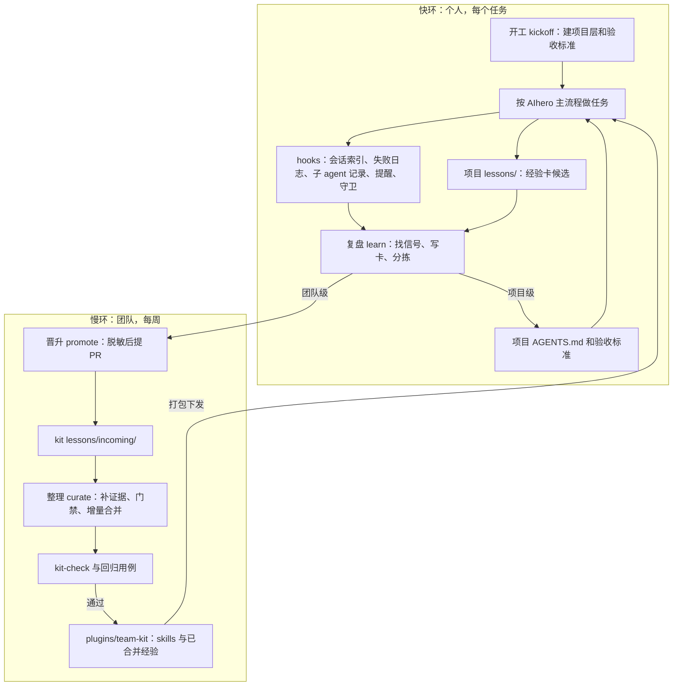

# 架构

团队 kit 是一个随任务自我改进的共享 agent 环境。

- **工作流从哪来**：用 AIhero 的 skills 原版；kit 只补团队层，也就是内核里的边界和红线、守卫、经验卡、验收标准（[ADR 0007](adr/0007-aihero-workflow.md)）。
- **质量靠什么**：每个项目的验收标准（`CODING_STANDARDS.md`，含全团队同步的团队基线），交付和审查时对照。规则管"什么算好"，不管"怎么做"，模型变强后也不会碍事。
- **进化什么**：agent 外围的文件，也就是内核、skill、经验卡和 hook 规则。不训练模型（[ADR 0001](adr/0001-evolve-the-environment.md)）。
- **靠什么进化**：人在任务里的纠正、工具失败后找到的做法、反复出现的手工步骤，以及花费明显超出任务需要的做法。
- **怎么防止进化歪**：门禁、回归用例、自主梯度，以及对 agent 只读的评判标准。
- **怎么防止规则变成阻碍**：只在某些模型上成立的经验写上适用模型；换模型时做消融；碍事的反证会让规则退役。学习环既加规则，也删规则。

## 1. 分层

| 层 | 内容 | 在哪 | 何时加载 | 谁改、门槛 |
|---|---|---|---|---|
| 内核 | 团队的边界、红线，一句指向工作流 | `plugins/team-kit/rules/team-core.mdc` | 每一轮对话 | 负责人批准，版本升 major（1.0 之前升 minor） |
| 工作流 | AIhero 的 skills：主流程、导航 `/ask-matt`、两线验收、复盘 | `~/.agents/skills/`，用 `npx skills` 安装 | description 命中，或输入 `/名字` | 不改原版；负责人先更新、跑回归，再通知大家 |
| 能力库 | 团队自己的 skill、工具用法、领域资料 | `plugins/*/skills/` | description 命中，或输入 `/名字` | 整理流程，过门禁并附回归用例 |
| 项目层 | 真实数据在哪、危险操作、已知坑；验收标准 | 项目的 `AGENTS.md`、`CODING_STANDARDS.md`、`HANDOFF.md` | `AGENTS.md` 每一轮；验收标准在交付和审查时 | agent 提议，本人确认；团队基线一节从 kit 同步 |
| 经验层 | 经验卡 | 项目 `lessons/`；kit 的 `lessons/` 和 `plugins/*/lessons/` | 开工时查；hook 在工具失败或执行命令前匹配 | agent 直接写候选，之后分拣、晋升、整理 |

内核是唯一每轮都加载的团队内容，所以只写模型自己不知道、也不该自己决定的团队边界：做法交给工作流和能力库，"什么算好"交给验收标准。kit-check 显示常驻规则的字数，超过参考值（600 字）时提醒逐句检查，不拦（[ADR 0002](adr/0002-thin-core.md)）。

## 2. 三个标准接口

任务简报、交接文档、经验卡的格式全团队统一，内容由各项目自己定（格式在 `plugins/team-kit/skills/kit-formats/`）。接口统一之后，经验能跨人汇总，项目能跨人交接。

最关键的是任务简报里的**完成标准**。它让 agent 交付前能自检，也是判断一次任务做得好不好的依据。日常任务没有自动评估器，完成标准加上人的确认，就是评估器。

完成标准管一次任务，**验收标准**管一个项目：项目的 `CODING_STANDARDS.md` 写这个项目里"什么算好"，开头一节是全团队一样的团队基线，由 `/kickoff` 从 kit 同步。AIhero 的 `/code-review` 会把它当作 Standards 一线，另一线对照需求，两线各开一个子 agent，分开汇报。

## 3. 两个学习环

### 快环：个人，每个任务

| 步骤 | 做什么 | 由谁执行 | 写到哪 |
|---|---|---|---|
| 记录 | 每轮结束记会话索引和纠正次数；工具失败记失败日志；启动子 agent 时记类型和模型 | `stop`、`postToolUseFailure`、`subagentStart` hook | `~/.team-kit/*.jsonl`，只在本机 |
| 记经验 | 被纠正、失败后修正、花费明显超出任务需要、发现省时间的事实时写卡 | agent，按内核 | 项目 `lessons/`，status: inbox |
| 复盘 | 读会话找五种信号（纠正、失败后修正、重复、缺信息、高消耗），写卡或追加证据，再按类型分拣 | `/learn` | `lessons/`、`CODING_STANDARDS.md` 的"本项目"、`AGENTS.md` 的"已知坑" |
| 结晶 | 第三次出现的流程提议写成 skill，稳定的步骤提议写成脚本 | `/learn` 提议，人同意 | 项目 `.cursor/skills/`、脚本 |

可选：在 `~/.team-kit/config.json` 里写 `"nudge": true`。会话里工具失败 3 次以上或被纠正 2 次以上时，`stop` hook 会自动追加一条消息，让 agent 复盘一次（每个会话最多一次）。

### 慢环：团队，每周

| 步骤 | 做什么 | 由谁执行 | 写到哪 |
|---|---|---|---|
| 晋升 | 团队级卡脱敏、泛化后提交：有 kit 仓库就开 PR；没有就导出一个文件发给负责人，用 `scripts/import-lessons.cjs` 导入 | `/promote` | `lessons/incoming/` |
| 整理 | 补证据、过门禁、增量合并进 skill、写回归用例、归档 | `/curate`，建议配成每周的 Cursor Automation | `plugins/team-kit/skills/`、`plugins/team-kit/lessons/`、`evals/cases/` |
| 验证 | 检查结构、格式、门禁、预算、密钥；回放回归用例 | `scripts/kit-check.cjs`（CI 上也跑）、`/eval` | `evals/results/` |
| 分发 | 打包成一个安装文件发给大家，运行一次即安装或升级；以后也可以导入团队市场自动下发 | `scripts/pack.cjs` | 每个人的 `~/.cursor/plugins/local/` |

### 收料

团队成员的材料（prompt、skill、工作流、工具、SOP、交接文档）放进 `intake/inbox/`，由 `/intake` 转成 `drafts/` 里的草稿 skill、`lessons/incoming/` 里的经验卡，或者内核提案。草稿和已有 skill 重叠时，用 `/eval` 做对比测试选胜者。材料只是慢环的另一个入口，同样要过门禁。

## 4. 经验怎么生效

| 路径 | 机制 | 适合 |
|---|---|---|
| 文本 | 判断类写进验收标准（项目一节，或团队基线）；查不到的事实写进项目 `AGENTS.md` 的"已知坑"；做法合并进团队 skill | 大多数经验 |
| 提醒 | 卡上有 `trigger`：工具失败且"工具名、命令、报错"命中时，`postToolUseFailure` hook 把规则注入对话 | 和特定工具、报错绑定的经验 |
| 守卫 | 卡上写了 `enforce: ask`：执行命中的 shell 命令前，`beforeShellExecution` hook 要求人确认 | 会花钱、覆盖数据、对外发送的命令 |
| 花费守卫 | 子 agent 要用 `plugins/team-kit/policy.json` 里列出的高价模型时，`subagentStart` hook 拦下；用户运行 `scripts/allow-expensive.cjs` 临时放开 | 限制模型和花费的团队约定 |

Cursor 在 `subagentStart` 上只支持放行或拦下，不支持询问，所以花费守卫是"先拦下、人主动放开"，放开有时限。

提醒和守卫只在命中时占用上下文，不增加常驻负担，所以机械类的经验（固定的命令写法、某类报错的解法）不进 `AGENTS.md`，直接加 trigger。一条经验写成文本后仍被反复违反，就给它加 trigger；还被违反，就加 `enforce: ask`。这样软规则会逐步变成硬检查。

## 5. 门禁与自主梯度

越靠近内核、影响的人越多，门槛越高：

- 项目里的 inbox：agent 随时可以写，没有门槛。
- 项目层：人确认后才写进 `AGENTS.md`。
- 团队能力库：满足其一才能合并：两条不同出处的证据、`severity: high`、负责人写了 `approved_by`。合并时必须附回归用例，kit-check 要通过，负责人要审 PR。
- 内核：只能由人改。整理流程只能在 PR 里写"内核提案"。

评判标准对 agent 只读：内核红线、回归用例、各任务的完成标准。agent 可以提议修改，但改 skill 和改评判它的回归用例不放在同一个 PR 里，免得同一个改动既出题又判卷。

有自动评估器的领域可以放宽门禁，见第 8 节。

### 退役

门禁让加规则变难，但只加不删，规则会越积越厚，模型变强后还会碍事。退役有两个触发：

- **反证**：成员复盘时发现 kit 的规则碍事（用户嫌确认太多、守卫拦下后放开且结果正常），记成那条规则的 obstruction 证据，经 `/promote` 追加到团队的卡上。两条以上不同出处的反证，kit-check 会提示。
- **消融**：团队换默认模型时，`/eval` 把相关经验的回归用例在有、无这条经验两种情况下各跑一遍，删掉后照样通过的就是新模型不再需要的。

`/curate` 把它们写进 PR 的"退役"一节：删掉对应文字，卡改为 stale。只在某些模型上成立的经验（卡上写了 `model`）不写进内核和 skill 正文，只由 hook 对匹配的模型提醒，这样不会拖累别的模型。

## 6. 度量

| 指标 | 来源 | 怎么看 |
|---|---|---|
| 每次会话的轮数、纠正次数、工具失败次数 | `plugins/team-kit/scripts/stats.cjs`，读本机日志 | 按周看同一项目的趋势；`/learn` 结尾会附上 |
| 每次会话的子 agent 个数、是否用到高价模型、被拦下几次 | 同一个脚本 | 找花费异常的会话，`/learn` 据此找"高消耗"信号 |
| 经验卡各状态的数量 | 同一个脚本，读项目 `lessons/` | inbox 长期堆积，说明没人分拣 |
| 常驻规则字数、待复核经验数、回归通过率 | kit-check、`/curate` 开的 PR | 每次整理时看 |

要证明 kit 在进化，就看同类任务的纠正次数和轮数是否随 kit 版本下降。

## 7. 信任边界

- 原始会话、会话索引和失败日志只留在各人电脑上。hook 写日志前会给疑似密钥打码。
- 离开本机的只有经过 `/promote` 脱敏、由本人确认的经验卡（[ADR 0006](adr/0006-local-first-privacy.md)）。导入脚本会跳过疑似含密钥的卡。
- 成员提交的原始材料放在 `intake/inbox/`，不进 git。
- kit-check 会扫描整个仓库的疑似密钥，CI 上发现就拦下。
- hook 出任何异常都放行，不会因为 kit 的 bug 卡住正常工作。

## 8. 领域包

有自动评估器的领域能力，做成 `plugins/<领域>/` 下的独立插件，在团队市场里设为 Default Off，只给相关的人装。比如 3D 生成可以用水密、流形、壁厚这类硬检查当评估器，打分规则可以用人工标注回放当评估器。领域包可以带自己的评测集；评估器通过的改动可以自动合并，这是唯一允许 agent 自己闭环的地方。加领域包的步骤见[运维](operations.md)。

## 9. 实现对照

| 概念 | 实现 |
|---|---|
| 内核 | `plugins/team-kit/rules/team-core.mdc` |
| 工作流 | AIhero 的 skills（mattpocock/skills），用 `npx skills` 安装；检测在 `plugins/team-kit/lib/aihero.cjs` |
| 标准格式 | `plugins/team-kit/skills/kit-formats/` |
| 建项目层 | `plugins/team-kit/skills/kickoff/` |
| 验收标准和团队基线 | `plugins/team-kit/skills/kickoff/templates/CODING_STANDARDS.md`；同步检查在 `plugins/team-kit/lib/standards.cjs` |
| 复盘、分拣、结晶 | `plugins/team-kit/skills/learn/` |
| 晋升 | `plugins/team-kit/skills/promote/`、`scripts/import-lessons.cjs` |
| 记录、提醒、守卫 | `plugins/team-kit/hooks/` |
| 花费策略 | `plugins/team-kit/policy.json`、`plugins/team-kit/lib/policy.cjs`、`plugins/team-kit/scripts/allow-expensive.cjs` |
| 经验卡解析和校验 | `plugins/team-kit/lib/cards.cjs` |
| 会话统计、项目层检查 | `plugins/team-kit/scripts/` |
| 整理、收料、回归 | `.cursor/skills/curate/`、`.cursor/skills/intake/`、`.cursor/skills/eval/` |
| 仓库检查 | `scripts/kit-check.cjs`、`.github/workflows/kit-check.yml` |
| 分发 | `scripts/pack.cjs`、`scripts/installer-template.cjs`；维护者本机用 `scripts/install.cjs`；团队市场用 `.cursor-plugin/marketplace.json` |

## 10. 已知限制

- 纠正次数靠关键词匹配，只用来看趋势和触发提醒；精确判断交给 `/learn`。
- hook 拿不到 token 用量和费用，花费只能用子 agent 个数和模型来近似。主对话用什么模型由人自己选，kit 只统计，不拦。
- 回归用例是"只出计划"的回放，检验的是 skill 有没有把经验写清楚，不是真实的执行结果。
- hooks 和内核只在 Cursor 里生效，其他工具只能用 skills。
- AIhero 的 skills 是英文、偏写代码。飞书表、外联、3D 这类任务主要靠内核、验收标准和团队自己的 skill。成员各自更新 AIhero 时，版本可能不一致。
- 需要 Node 18 以上。
